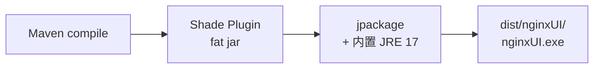

# nginxUI-win

> Nginx 管理界面 —— Windows 离线桌面版

基于 Java 17 + 纯 Swing 构建的 Nginx 可视化管理工具，无需 Web 服务、无需 Spring 容器，双击即运行。

---

## ✨ 功能特性

| 模块 | 说明 |
|------|------|
| 🔍 **多实例发现** | 自动扫描本机所有 Nginx 安装目录，支持手动添加/忽略 |
| 📊 **实时仪表盘** | 进程状态、CPU/内存、连接数、请求量、响应码分布 |
| 🛠 **配置编辑器** | Nginx 配置文件语法高亮编辑，支持模板库一键导入 |
| 🌐 **站点管理** | 虚拟主机（server block）的增删改查与启用/禁用 |
| 🔐 **证书库** | SSL 证书集中管理，自动检测过期时间，HTTPS 一键启用 |
| 🔄 **版本升级** | 下载并替换 Nginx 新版本，支持回滚 |
| 📜 **日志查看** | Access / Error 日志实时滚动，支持关键字过滤 |
| ⚙️ **服务控制** | 启动 / 停止 / 重载配置，支持注册为 Windows 服务 |

---

## 🖥 运行环境

- **操作系统**：Windows 10 / 11 / Server 2016+
- **Java 版本**：17+（构建产物已包含内置 JRE，无需单独安装）
- **Nginx**：用户自行安装（`nginx.exe` 所在目录）

---

## 🚀 快速开始

### 方式一：使用预编译版本

从 [GitHub Releases](https://github.com/monitor1370/nginxUI-win/releases) 下载 `nginxUI-x.x.x-win-x64.zip`，解压后运行 `nginxUI.exe`。

### 方式二：从源码构建

```powershell
# 克隆仓库
git clone https://github.com/monitor1370/nginxUI-win.git
cd nginxUI-win

# Maven 构建（产出 fat jar）
mvn clean package

# 运行
java -jar target/nginxui-win.jar
```

### 方式三：打包为 Windows 可执行程序

```powershell
.\build.ps1
```

构建产物位于 `dist/nginxUI/` 目录，包含内置 JRE，双击 `nginxUI.exe` 即可运行。

---

## 📁 项目结构

```
nginxUI-win/
├── src/main/java/com/nginxui/
│   ├── Main.java                    # 入口
│   ├── ext/                         # 外部扩展（Dashboard 解析等）
│   ├── ui/                          # Swing 界面组件
│   │   ├── MainFrame.java           # 主窗口
│   │   ├── CertManagerPage.java     # 证书管理页
│   │   ├── ConfigTemplatesPage.java # 配置模板页
│   │   ├── ConfPage.java            # 配置编辑页
│   │   ├── MonitorPage.java         # 监控页
│   │   ├── SitePage.java            # 站点管理页
│   │   └── ...
│   └── utils/                       # 工具与服务层
│       ├── NginxConfigService.java
│       ├── NginxControlService.java
│       ├── NginxDiscoveryService.java
│       ├── NginxHttpsManager.java
│       ├── NginxInstallManager.java
│       └── ...
├── src/main/resources/
│   ├── i18n/                        # 国际化 (中/英)
│   ├── logback.xml                  # 日志配置
│   └── winsw/winsw.exe              # Windows 服务包装器
├── pom.xml
├── build.ps1                        # 打包脚本 (jpackage)
└── clean.ps1
```

---

## 🛠 技术栈

| 组件 | 版本 | 用途 |
|------|------|------|
| Java | 17 | 运行时 |
| Maven | 3.9+ | 构建工具 |
| FlatLaf | 3.5.x | 现代 Swing 外观（浅色/深色主题） |
| Hutool | 5.8.x | 通用工具库（JSON/IO/加密/进程调用） |
| OSHI | 6.4.x | 系统信息采集（CPU/内存/进程） |
| Logback | 1.2.x | 日志框架 |
| WinSW | - | 将 Nginx 注册为 Windows 服务 |

---

## 📝 构建说明

本项目使用 Maven Shade Plugin 生成 fat jar（`nginxui-win.jar`），再通过 `jpackage` 打包为 Windows 原生可执行程序。



---

## 📄 License

本项目暂未指定开源许可证，版权归作者所有。
